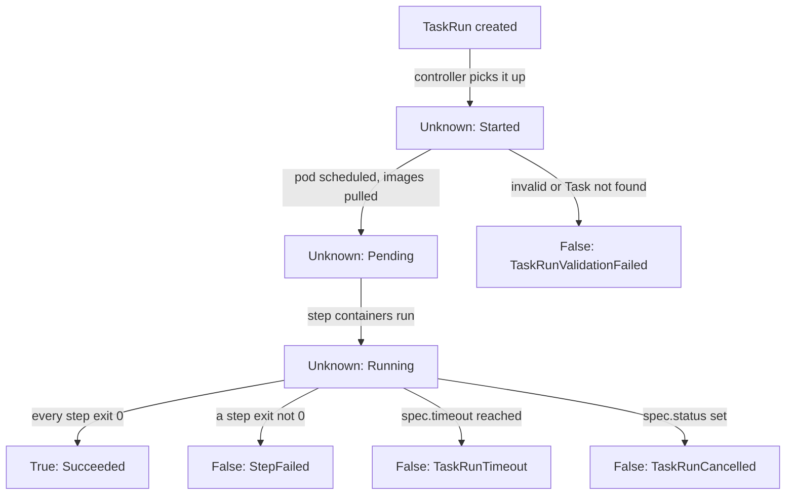

# The TaskRun Lifecycle And Step Termination States

A `TaskRun` that failed tells you more than "failed". Its `Succeeded` condition says in which phase it stopped, and `status.steps` says how each step ended: completed, failed, skipped, out of time. Reading both is the fastest way from a red run to its cause. This part walks a `TaskRun` through its life and makes each step end state happen once.

## From created to done

A `TaskRun` (one execution of a `Task`) has one status condition of the type `Succeeded`. While it runs, the `status` is `Unknown` and the `reason` moves forward; when it ends, the `status` is `True` or `False` and stays there.



The diagram shows the common path and the most common ways out. The tekton-pipelines-controller sets each reason: `Started` when it first sees the run, `Pending` while the pod waits, `Running` while steps run, and a final reason when the pod ends or a check fails. A run created with `spec.status: TaskRunPending` stays `Unknown` with the reason `TaskRunPending` and gets no pod until you remove that field. The field `spec.retries` makes Tekton try a failed run again a given number of times, and keeps the earlier attempts in `status.retriesStatus`.

## How each step ended

Every step leaves an entry in `status.steps`, in the order of the `Task`. Each entry has `terminated.exitCode`, the exit code of the step, and `terminationReason`, the end state that Tekton records:

| `terminationReason` | Meaning |
| --- | --- |
| `Completed` | The step ended with exit code 0 |
| `Error` | The step ended with a non-zero exit code |
| `Skipped` | The step never ran, because a step before it failed (or its `when` expression was false) |
| `Continued` | The step failed, but it has `onError: continue`, so the run went on |
| `TimeoutExceeded` | The step ran longer than its own `timeout` |
| `Cancelled` | The run was cancelled while the step ran |

The `Task` below has three steps. The second fails on purpose.

<!-- astrona:playground:renew -->

Save this as `task-launch-sequence.yaml`:

```yaml
apiVersion: tekton.dev/v1
kind: Task
metadata:
  name: launch-sequence
  namespace: starfleet
spec:
  params:
    - name: fail-at
      type: string
      default: "none"
    - name: wait-seconds
      type: string
      default: "0"
  steps:
    - name: prepare
      image: busybox:1.37.0
      script: |
        #!/bin/sh
        echo "preparing"
    - name: ignite
      image: busybox:1.37.0
      timeout: 5s
      script: |
        #!/bin/sh
        sleep "$(params.wait-seconds)"
        if [ "$(params.fail-at)" = "ignite" ]; then
          echo "ignition failed" >&2
          exit 3
        fi
        echo "ignited"
    - name: lift-off
      image: busybox:1.37.0
      script: |
        #!/bin/sh
        echo "lift-off"
```

Apply it, and run it once so that `ignite` fails:

```sh
kubectl apply -f task-launch-sequence.yaml
tkn task start launch-sequence -n starfleet -p fail-at=ignite --use-param-defaults --showlog
```

`tkn` prints the name of the `TaskRun`. Use it in place of `<NAME>`:

```sh
kubectl get taskrun <NAME> -n starfleet -o jsonpath='{.status.conditions[0].reason}{": "}{.status.conditions[0].message}{"\n"}{range .status.steps[*]}{.name}{" exit "}{.terminated.exitCode}{" "}{.terminationReason}{"\n"}{end}'
```

The reason is `StepFailed`, and the message says that `step-ignite` exited with code 3. `prepare` shows `Completed`, `ignite` shows exit code `3` and `Error`, and `lift-off` shows `Skipped`. The entrypoint binary of `lift-off` saw that the step before it failed and never started your script. Only the first failed step holds the real error.

## Step timeouts and run timeouts

`ignite` has `timeout: 5s`. A step timeout is enforced by the entrypoint binary inside the container: when the time runs out, it stops the step's process. Make the step sleep longer than that:

```sh
tkn task start launch-sequence -n starfleet -p wait-seconds=20 --use-param-defaults --showlog
```

Read the status the same way. The reason is again `StepFailed`, but the message now says that `step-ignite` exited because the step exceeded the specified timeout limit, and the step shows `TimeoutExceeded`. The pod is still there, with its logs.

The whole `TaskRun` has a timeout too: `spec.timeout`, by default 60 minutes from `config-defaults`. It works differently. When a run passes it, the tekton-pipelines-controller marks the run `False` with the reason `TaskRunTimeout` and deletes the pod to stop the steps, so the step logs are gone. Try it with a run that has a short timeout.

Save this as `taskrun-launch-timeout.yaml`:

```yaml
apiVersion: tekton.dev/v1
kind: TaskRun
metadata:
  name: launch-timeout
  namespace: starfleet
spec:
  taskRef:
    name: launch-sequence
  timeout: 10s
  params:
    - name: wait-seconds
      value: "4"
```

Apply it:

```sh
kubectl apply -f taskrun-launch-timeout.yaml
```

Then check the result after about 15 seconds:

```sh
kubectl get taskrun launch-timeout -n starfleet -o jsonpath='{.status.conditions[0].reason}{"\n"}'
kubectl get pod launch-timeout-pod -n starfleet
```

Pulling and starting the pod takes some of the 10 seconds, so the run often times out before `ignite` ends. If the run still succeeds on your machine, set `wait-seconds` closer to `5`. When it times out, the reason is `TaskRunTimeout`, and `kubectl get pod` reports that the pod was not found. Cancelling works the same way: setting `spec.status` to `TaskRunCancelled` (or `tkn taskrun cancel <name>`) makes the controller delete the pod and set the reason `TaskRunCancelled`.

You can now follow a `TaskRun` through its reasons, read the end state of each step, and tell a step timeout from a run timeout. The open question is how to let a step fail without ending the run, so that a later step can react to the failure.

## Common pitfalls

> [!WARNING]
> - **Reading only the last step.** `Skipped` steps never ran. Find the first step with `Error` or `TimeoutExceeded`.
> - **Looking for logs after `TaskRunTimeout` or a cancel.** The controller deleted the pod. Use a step `timeout` when you want to keep the logs.
> - **Treating `Unknown` as an error.** `Unknown` means the run has not ended yet. Wait for `True` or `False`.
> - **Editing a running `TaskRun` to change its timeout.** The `spec` cannot change after the run started; only `spec.status` can be set to cancel it.
